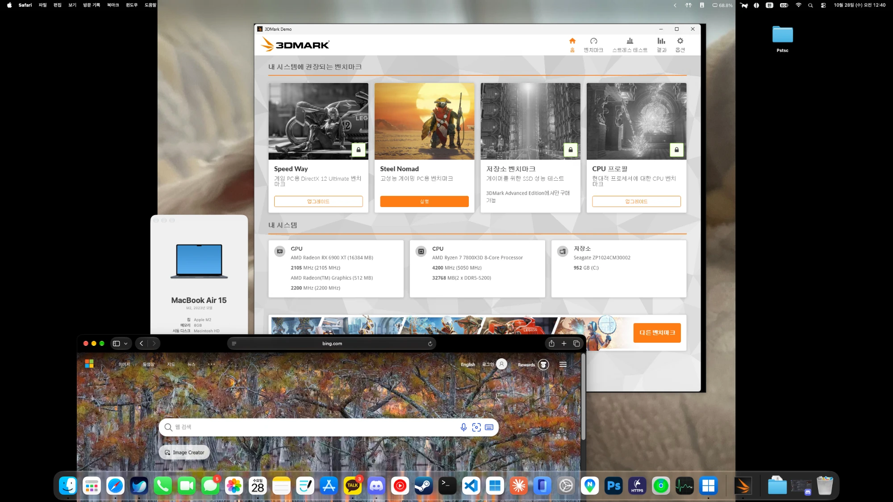
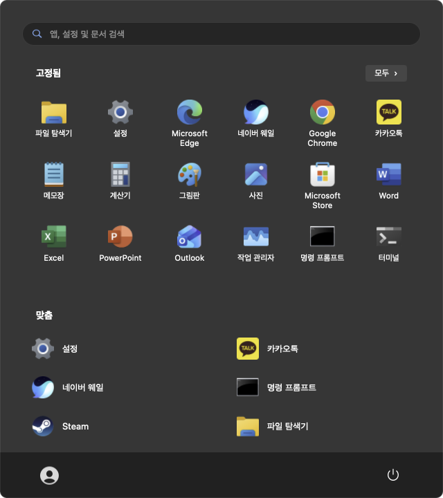
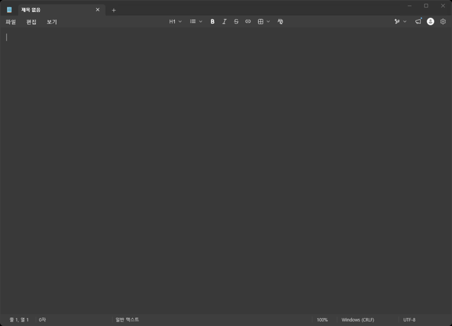
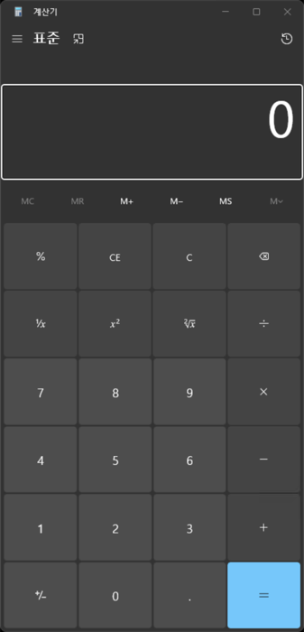

# Pstsc

[한국어](README.md) | **English** | [日本語](README.ja.md)

**Run apps from a remote Windows PC as native-looking Mac windows: a macOS RemoteApp (RDP) client with Parallels Coherence-style seamless windows.**



*A MacBook Air (M2, 8 GB) running 3DMark from a remote Windows PC with a Ryzen 7 7800X3D and an RX 6900 XT. No Windows desktop, just the program's window as a Mac window, with its own icon in the Dock next to Pstsc's Windows icon.*

Pstsc brings the programs of a Windows PC you already own onto your Mac, one window at a time, much like Parallels Desktop's Coherence mode. Instead of installing Windows inside the Mac, it connects to the Windows PC over Remote Desktop (RDP RemoteApp). Each remote program gets its own Dock icon, and there is a Windows 11 style Start menu plus Spotlight and Launchpad launchers.

> A personal project. Not affiliated with Microsoft or Parallels.

> The app's interface follows your Mac's language: **English, Korean or Japanese** (other languages fall back to English).

## Screenshots

| Start menu, opened from the Dock icon | Remote Notepad as a Mac window | Remote Calculator |
|:---:|:---:|:---:|
|  |  |  |

The Start menu is drawn by Pstsc on the Mac; Notepad and Calculator are running on the remote Windows PC. Each shows up as its own Mac window.

## Features

**Windows and display**
- Each window of a remote program becomes one Mac window (RDP RemoteApp). The remote desktop itself is never shown.
- Dragging a window moves it on the Mac immediately; the remote PC is told the new position only when you let go.
- Multiple displays: your Mac's display layout is sent to the remote PC, so windows can move between displays.
- Desktop mode shows the whole remote desktop in one window. Switch between app mode and desktop mode at any time.

**Dock and launching**
- Clicking the Pstsc Dock icon opens a Windows 11 style Start menu with search, pinned apps, all apps (grouped #, A–Z, ㄱ–ㅎ), recent apps and a power menu.
- Every running remote program gets a Dock icon with its own name and icon. Click it to bring its windows forward, right-click for its window list, or quit it to close the remote program.
- The remote Start menu apps are registered in `~/Applications/Pstsc 앱/` ("Pstsc apps"), so you can launch them from Spotlight and Launchpad. If Pstsc isn't running, it starts and connects first.

**Connection**
- Saves your password in the macOS Keychain and connects as soon as Pstsc starts. Can also open at Mac login.
- Reconnects automatically after network drops and when the Mac wakes from sleep.
- The remote session stays signed in even when every remote program is hidden in the tray, so tray apps such as messengers keep running.

**Also**
- Remote sound plays on the Mac.
- Your Mac home folder appears in the remote File Explorer as a `Mac` drive for exchanging files.
- Balloon notifications from remote tray icons appear in the Mac Notification Center.
- Keyboard: left ⌘ is sent as Ctrl, so ⌘C and ⌘V work as on a Mac. Right ⌘ sends the Korean/Japanese IME toggle key (scan code 0x72: Hangul on Korean Windows, Kana on Japanese Windows).
- The **Remote PC Resource Usage** menu item measures how much CPU and memory this connection uses on the remote PC.

## Requirements

| | |
|---|---|
| Mac | **Apple Silicon** (M1 or later), macOS 14 or later. Intel Macs are not supported yet (see below). |
| Mac account | Administrator (the app installs into `/Applications`) |
| Developer tools | Xcode Command Line Tools (Swift 6 or later), [Homebrew](https://brew.sh) |
| Library | FreeRDP 3.32 or later (`brew install freerdp`) |
| Remote PC | Windows 10/11 **Pro** or higher, or Windows Server, with Remote Desktop available. Home editions cannot be RDP hosts. |

## Installation

There is no prebuilt app yet: you download the source and **build it on your own Mac**. The first time takes about 10 minutes.

### 1. Install the Xcode Command Line Tools

Open Terminal (Applications → Utilities → Terminal) and run the following, then click **Install** in the window that appears. Skip this if Xcode is already installed.

```bash
xcode-select --install
```

### 2. Install Homebrew

Skip if you already have it. It will ask for your Mac login password.

```bash
/bin/bash -c "$(curl -fsSL https://raw.githubusercontent.com/Homebrew/install/HEAD/install.sh)"
```

When it finishes, run the two PATH commands shown under `Next steps`, then open a new Terminal window.

### 3. Install FreeRDP

```bash
brew install freerdp
```

### 4. Download and install Pstsc

```bash
git clone https://github.com/D-opamin-e/pstsc.git
cd pstsc
scripts/build-app.sh
```

It succeeded when the last line reads `설치됨 / Installed / インストール完了: /Applications/Pstsc.app`. The script makes a release build, packages `Pstsc.app` with its icon and puts it in your Applications folder.

### 5. Run

Open **Pstsc** from Applications. Right-click its Dock icon → Options → **Keep in Dock** for easy access. Because you built it yourself, there is no "unidentified developer" warning.

On first launch macOS may ask for the following. Allow them for the related features to work:
- Notifications: remote notifications as Mac notifications
- Keychain access: connecting automatically with the saved password
- Desktop, Documents and Downloads folder access: when the remote PC opens the `Mac` drive

### Updating

Quit Pstsc (⌘Q) first, then:

```bash
cd pstsc
git pull
scripts/build-app.sh
```

### Uninstalling

Quit Pstsc, then remove the following. To remove the saved password, delete the `com.pstsc.agent` item in Keychain Access.

```bash
rm -rf /Applications/Pstsc.app "$HOME/Applications/Pstsc 앱" \
  "$HOME/Library/Application Support/Pstsc" "$HOME/Library/Logs/Pstsc"
defaults delete com.pstsc.agent
```

### Installation problems

| Symptom | Fix |
|---|---|
| `xcrun: error: invalid active developer path` | Run step 1 (`xcode-select --install`) again. |
| `brew: command not found` | The PATH setup at the end of step 2 was skipped. Run the two commands it showed and open a new Terminal. |
| `'freerdp/...' file not found` or `library 'freerdp3' not found` | FreeRDP is missing, or this is an Intel Mac. Check `brew install freerdp`. Intel Macs are not supported yet. |
| `Permission denied` (Applications) | Not an administrator account. Run it from an administrator account. |

### Running during development

To try code changes without installing the app (`swift build` comes first so the Dock helper binary is built too):

```bash
swift build && swift run PstscAgent
```

## Preparing the remote PC

After installing on the Mac, set up the Windows PC you will connect to, once:

1. Turn on **Settings → System → Remote Desktop**.
2. Copy [`remote/enable-remoteapp.reg`](remote/enable-remoteapp.reg) from this repository to the remote PC and double-click it (administrator rights needed). It allows programs that are not registered as RemoteApps to run.
3. (Recommended) Apply [`remote/single-session.reg`](remote/single-session.reg) the same way. It makes reconnections with the same account always reuse the existing session.
4. Restart the remote PC.
5. To connect from outside your network, the RDP port (3389 by default) must be forwarded to the PC on your router. A VPN or something like Tailscale is the safer option.

## Usage

1. Start Pstsc and enter the remote PC's address, user name and password. For a Microsoft account, use `MicrosoftAccount\your@email` as the user name and the account password (not the PIN).
2. Once connected, click the Pstsc Dock icon and launch programs from the Start menu.
3. To see the whole remote desktop, choose the Start menu's power button → **Show Windows Desktop**.

| To | Do |
|---|---|
| Launch a program | Pstsc Dock icon → Start menu, or search its name in Spotlight |
| Pin or unpin an app | Right-click it in the Start menu |
| List remote windows | Menu bar **Window** menu, or right-click a Dock icon |
| Toggle the IME (Korean/Japanese) | Right ⌘ |
| Exchange files | The `Mac` drive in the remote File Explorer (`\\tsclient\Mac`) |
| Disconnect, restart the remote PC | Power button in the Start menu |

## How it works

```
[Remote Windows PC]
   ├─ RemoteApp session: each program window sent separately (RDP graphics pipeline)
   └─ Pstsc helper PowerShell (runs without a window)
        exports the Start menu list and icons, keeps a 1×1 window open to hold the session
        │
        │  one RDP connection (FreeRDP)        shared folder \\tsclient\pstsc
        ▼
[Pstsc.app on the Mac]
   ├─ one remote window = one borderless Mac window; mouse and keyboard forwarded
   ├─ Windows 11 style Start menu; connect, reconnect, mode switching
   └─ one small proxy app per program (Dock icon, Launchpad/Spotlight launchers)
```

- RDP and RemoteApp are handled by the [FreeRDP](https://www.freerdp.com) library, through a thin C layer ([`Sources/PstscRDP`](Sources/PstscRDP)) used by the Swift/AppKit app.
- Per-program Dock icons come from small .app bundles created and launched for each program. The windows themselves are drawn by the main Pstsc app.

### What Pstsc does on the remote PC

Stated openly. All of it happens only inside the session Pstsc connects to.

- On connect it runs `helper.ps1` from the shared folder without a window (`conhost --headless powershell`), which:
  - exports the Start menu list with `Get-StartApps`,
  - exports app icons (96 px), skipping ones already received,
  - keeps one 1×1 window open, because Windows signs out a RemoteApp session that has no visible app window,
  - replaces a Pstsc helper left over from a previous connection in the same session.
- Steady memory use is about 25 MB (about 10 MB for PowerShell plus conhost).
- The **Remote PC Resource Usage** menu item runs a fixed measuring script (`resources.ps1`) once.

## What is stored on the Mac

| Item | Location |
|---|---|
| Password | Keychain, service name `com.pstsc.agent` |
| Address, user, settings | `defaults read com.pstsc.agent` |
| Shared folder, app list, icons | `~/Library/Application Support/Pstsc/` |
| Per-program Dock proxy apps | `~/Library/Application Support/Pstsc/Apps/` |
| Launchpad/Spotlight launchers | `~/Applications/Pstsc 앱/` |
| Log | `~/Library/Logs/Pstsc/agent.log` (rewritten at each launch) |

## Security notes

- The server certificate is trusted and stored on first connection (TOFU). A changed certificate is refused afterwards.
- With home folder sharing on, the remote PC can access your Mac home folder. Turn it off in the menu if you don't need it.
- The built app is ad-hoc signed, not signed with a developer certificate. Copied to another Mac, it may trigger a Gatekeeper warning.

## Known limitations

- **The real Windows Start menu, search and Action Center are not delivered over RemoteApp.** That is why Pstsc draws its own look-alike Start menu. Desktop mode opens the real one.
- Windows 11 toast notifications are not delivered; only tray-icon balloon tips become Mac notifications.
- Remote tray icons can't be clicked directly. A program hidden in the tray opens again when you launch it from the Start menu or Spotlight.
- Clicking a remote window directly makes Pstsc, not that program, the active app in the Dock and ⌘Tab.
- The resize handles of Windows 11 windows sit outside the visible border and may not be grabbable.
- Clipboard sharing, remote cursor shapes and Retina resolution are not supported yet. The screen is received at one pixel per Mac point.
- Connecting or disconnecting a display takes effect after reconnecting.
- Intel Macs are not supported yet: the build settings assume the Apple Silicon Homebrew path (`/opt/homebrew`).
- No prebuilt app is distributed. A built app uses the FreeRDP installed on that Mac, so copying it to another Mac doesn't work.

## Troubleshooting

- **The connection keeps dropping and coming back**: another device (for example Microsoft's Windows App) is connected with the same account, and the two keep taking the session from each other. Use one at a time.
- **"The remote PC is already in use"**: someone (or the same account) is signed in at the remote PC. Windows Pro allows only one active session, so app window mode can't connect. Click the **Connect in Desktop Mode** button in the connect window to take over that session (the remote PC is then locked). Two people using it at the same time is not possible on Windows Pro — that needs a Hyper-V VM or Windows Server.
- **It prints "already running" and quits**: Pstsc is already running. Only one instance runs at a time.
- **Programs don't start**: check that `enable-remoteapp.reg` was applied on the remote PC.
- **Anything else**: see `~/Library/Logs/Pstsc/agent.log`. To protect your privacy it records only connection status and errors; window titles, launched apps, the remote address and account are never logged. FreeRDP's own log includes the remote PC name and account, so it is off by default. Turn it on only for debugging, e.g. `WLOG_LEVEL=INFO swift run PstscAgent`, and don't post that log publicly.

## Project layout

| Path | Contents |
|---|---|
| `Sources/PstscRDP/` | C wrapper around FreeRDP: connection thread, RemoteApp window state, per-window frames, input, icons, notifications |
| `Sources/PstscAgent/` | The Mac app (Swift/AppKit) |
| `Sources/PstscDockProxy/` | Helper app for per-program Dock icons and Launchpad launchers |
| `scripts/build-app.sh` | Builds and installs `Pstsc.app` |
| `scripts/test-remoteapp.sh` | Tests RemoteApp alone with xfreerdp |
| `remote/` | Registry files for the remote PC, a test `.rdp` file |
| `docs/images/` | README screenshots |
| `PLAN.md`, `PROGRESS.md` | Design and development notes (Korean) |

## License

[MIT License](LICENSE)

## Credits

- [FreeRDP](https://github.com/FreeRDP/FreeRDP) (Apache License 2.0): RDP protocol implementation
